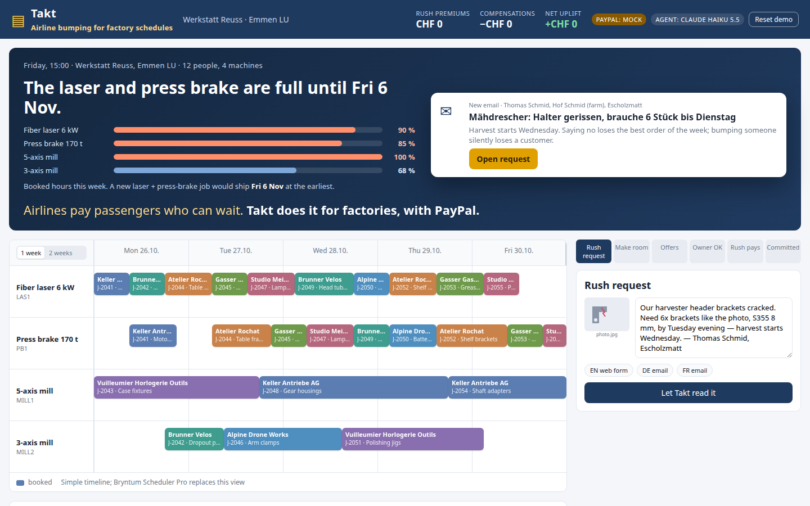
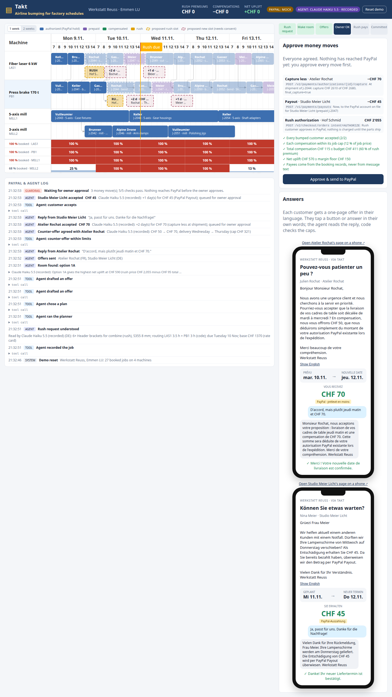
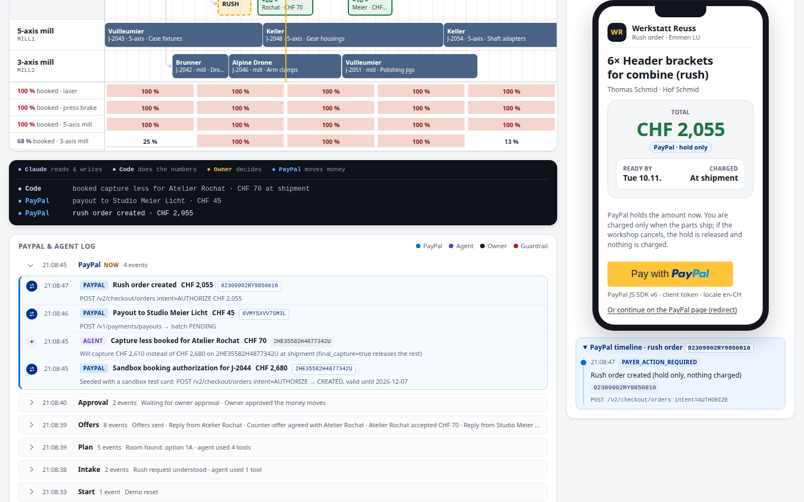
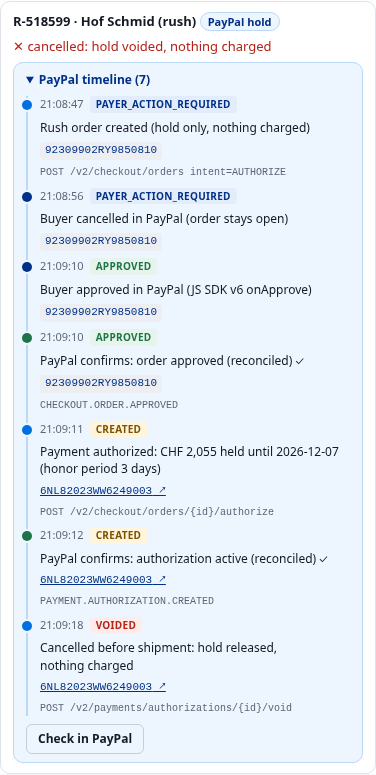
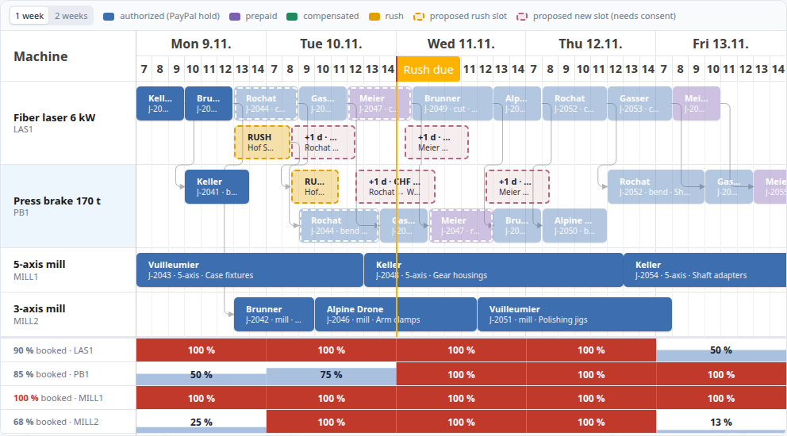
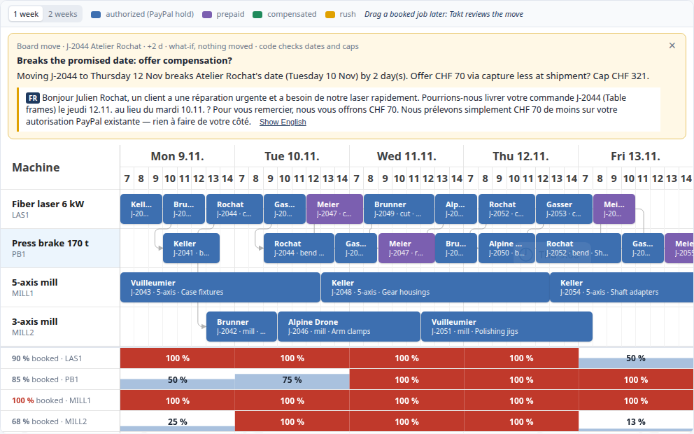

# Takt — airline bumping for factory schedules

When a job shop's schedule is full and a rush order arrives, Takt makes room. It finds booked customers who can wait, pays them for it through PayPal, and charges the rush customer a premium that covers the compensation. The schedule only changes when PayPal confirms the money moves.

> Status: phase 2.
> - **AI:** a Claude Haiku 5.5 agent with tool use reads rush requests, picks whom to ask, writes the offers and negotiates replies, inside code-enforced guardrails and an owner approval step. It scores 17/17 on the eval.
> - **PayPal:** runs against the real sandbox (verified end-to-end in CHF) or an offline mock. The rush customer pays with the **PayPal JS SDK v6** button (redirect as fallback), and every job shows its PayPal timeline: order, approval, authorization, capture, void, refund, payout, each with its PayPal id.
> - **Timeline:** Bryntum Scheduler Pro (trial). Machines are resources, operations are events with cut → bend dependencies, a resource histogram shows the shop at 100 %, the agent's proposal appears as ghost events, and the accepted plan slides in when PayPal confirms. Drag a booked job later and Takt reviews the move.
> - **Hosting-ready:** each browser gets its own demo shop (cookie session, 2 h TTL), so judges never share or reset each other's state. Render plan and `render.yaml`: [docs/DEPLOY.md](docs/DEPLOY.md) (not deployed yet).



## Run locally

```bash
npm install
cp .env.example .env     # optional: add PayPal sandbox credentials
npm run dev              # API on :8787, web on http://localhost:5173
npm test                 # unit, guardrail, HTTP/session tests; demo path 10x with rules and 10x with recorded Claude responses
npm run agent:eval       # 17-case agent eval (replays recordings, free, report untouched; add -- --live to re-run on Claude, ~USD 0.01)
npm run dev:sandbox      # same app against the real PayPal sandbox
npm run smoke:sandbox    # the whole money story against the sandbox, 16 checks (headless buyer approval)
npm run build && npm start   # production: one process serves API + built web app on :8787
npm run screenshot [url]     # Playwright demo-path run with checks + screenshots (DEMO_RUNS=3, DEMO_CANCEL_FIRST=1, PAY_VIA=sdk|redirect)
```

**Hosting (Render or similar, see [docs/DEPLOY.md](docs/DEPLOY.md) and `render.yaml`).** `npm ci --include=dev && npm run build`, start `npm start`, health check `/healthz`. Express trusts one proxy hop (`trust proxy`), so client IPs and `https` are correct behind Render. Set `PUBLIC_BASE_URL` to the public URL (otherwise it is taken from the request host); PayPal returns the buyer to `/api/paypal/return` and a cancelled checkout to `/api/paypal/cancel`. Live-AI limits (only live Claude calls count, recorded replays are free and unlimited): `AGENT_MAX_LIVE_PER_SESSION_HOUR` (12), `AGENT_MAX_LIVE_PER_IP_HOUR` (40), `AGENT_MAX_LIVE_PER_DAY` (300), plus the per-process `AGENT_MAX_USD` ceiling. When a limit is reached the step runs on the rules and the UI says so. Also set a spend limit in the Anthropic Console.

Without credentials the header shows **PayPal: MOCK**. The agent badge shows **Claude Haiku 5.5 · live** when `ANTHROPIC_API_KEY` is set, **· recorded** when a scripted demo input is replayed from `server/agent/llm-cache/` (no key needed), or **rules (fallback)**. `AGENT_MODE=deterministic` forces the rules. Once `PAYPAL_CLIENT_ID` and `PAYPAL_CLIENT_SECRET` are set (in `.env`, or in the parent workspace's `.env`), it switches to the real sandbox.

### Sandbox notes

- **Rush customer:** the rush checkout (inline in the console, or `#/pay` on a phone) shows the **PayPal JS SDK v6** button. It loads with a browser-safe client token from `/api/paypal/client-token` and opens PayPal in a popup; `onApprove` sends the order id to the server, which authorizes it. Log in with a sandbox *personal* account (choose the card, not a bank account, as funding). Closing the popup shows "closed the PayPal window" in the console; the button keeps working. **Fallback:** "Or continue on the PayPal page (redirect)" uses the order's `payer-action` link; there you can also pay as a guest with test card `4005519200000004`, any future expiry, CVV `123`. The server also polls the order, so an approval is never lost.
- **Language:** orders carry `experience_context.locale = en-CH` and the SDK uses `locale: 'en-CH'` (`PAYPAL_LOCALE`), so PayPal's login page is English. After login PayPal switches to the buyer account's own language and country; that can't be forced. Use a sandbox buyer created with country Switzerland and English (see [docs/DEPLOY.md](docs/DEPLOY.md)).
- **Repeat runs:** every demo run (and every Reset) gets a run id, so PayPal invoice ids never repeat (`DUPLICATE_TRANSACTION`) while a double-clicked Ship stays idempotent (same `PayPal-Request-Id`).
- **Seeded bookings** have placeholder authorizations. The first time Takt touches one, it creates a real sandbox authorization for the same amount with PayPal's test card (logged as "Sandbox booking authorization").
- **Payouts** go to `PAYPAL_SANDBOX_PAYOUT_RECEIVER` when it is set. Otherwise they end `UNCLAIMED`, because the seeded emails have no PayPal account.
- **No webhooks needed:** after each money move the server polls the resource and feeds a webhook-shaped event (`RECON-…`) into the same handler that verified webhooks use.

## How AI is used

Takt's agent is **Claude Haiku 5.5** (`claude-haiku-5-5`), called through the Anthropic Messages API with tool use (`server/agent/claude.ts`). It runs three short agent loops. Each one has typed, strictly validated tools.

| Step | What Claude does | Tools it calls (code behind them) |
|---|---|---|
| **Intake** | Reads a free-text rush request in DE/FR/EN, e.g. *"Brauche 6 Halter S355 8mm bis Dienstag"* | `record_rush_job`: code turns part family × qty × thickness into machine hours and a rate-card price |
| **Make room** | Asks the planner for options, decides whom to ask (cost, relationship notes, stated flexibility) and justifies it to the owner. Then writes a personal offer per customer in their language | `plan_bump_options` (the deterministic finite-capacity planner, can exclude customers) → `choose_bump_plan` → `draft_offer` (rejected if the text states a different amount or day) |
| **Negotiate** | Interprets free-text replies: yes, no, *"d'accord, mais plutôt jeudi matin et CHF 70"*, questions, manipulation attempts. Answers in the customer's language | `accept_offer`, `counter_offer` (re-checked against caps and feasible dates), `reply_to_customer`, `decline_offer` (→ re-plan), `escalate_to_owner` |

**Guardrails.** Code, not the model, decides every amount. These limits hold whatever the model writes, for Claude and for the rules fallback alike:
- per-job cap of 12 % of the job price;
- minimal concession: a counter-offer is agreed without the owner only up to the opening amount + 50 % (at least CHF 20); bigger asks get one modest step up (CHF 10-30) and then go to the owner;
- rush budget: all compensations together at most 60 % of the rush premium;
- margin floor of CHF 150;
- delivery dates no earlier than the planner allows;
- no CHF amount above the cap in any message.

Payees always come from booking records. Customer text is wrapped as untrusted data. **No money moves until the shop owner clicks "Approve & send to PayPal"**, and the checks are re-run at that moment. Every tool call, guardrail rejection, approval and PayPal call appears in the **PayPal & agent log**.

**Never fails on stage.**
- If the API errors, is rate-limited, hits the spend ceiling, refuses, or doesn't finish, that step runs on the rule-based agent and the badge and a note in the flow say so. The rules never invent an order: unreadable text ("hello") gets a question to the owner instead of a job.
- Responses for the scripted demo inputs are recorded (record/replay keyed by the exact request), so the hosted demo and the video replay real Claude output at zero cost.
- New inputs go live, limited per session, per IP and per day, and by a per-process USD ceiling. Replays never count.

**Eval.** [docs/AGENT_EVAL.md](docs/AGENT_EVAL.md): 17/17 cases pass (the full live run cost USD 0.007; the FR/DE path cases were added later for USD 0.003). The cases cover DE/FR/EN intake, plans (each sample is a real squeeze: the FR email bumps the French and a German customer), the scripted replies on the DE and FR paths, accept, decline, counter, over-cap and question replies, and a prompt injection that demands a CHF 2000 payout to a new email; that one is escalated to the owner and nothing changes.



## How PayPal is used

| Step | API |
|---|---|
| Rush customer pays (hold only) | `POST /v2/checkout/orders` (intent `AUTHORIZE`, `locale en-CH`), **JS SDK v6** PayPal button with a server-issued client token (`POST /v1/oauth2/token response_type=client_token`), `onApprove` → `POST /v2/checkout/orders/{id}/authorize`. Redirect (`payer-action` link) as fallback |
| Owner approves the money moves | Nothing below runs before this click; guardrail checks are re-run |
| Bumped customer who booked with an authorization | At shipment: `POST /v2/payments/authorizations/{id}/capture` for the authorized amount minus the compensation, with `final_capture:true` |
| Bumped customer who already paid in full | `POST /v1/payments/payouts` |
| Rush cancelled before shipment | `POST /v2/payments/authorizations/{id}/void`: "Cancel rush (void)" in Settle. The premium is lost, the bumped customers keep their compensation |
| Rush cancelled after shipment | `POST /v2/payments/captures/{id}/refund` (full): "Parts returned: refund" in Settle. Partial refunds (late-delivery policy) verified by `npm run smoke:sandbox` |
| Status, per job | PayPal timeline with every id (order, authorization, capture, refund, payout batch), each marked as our call, buyer action, PayPal confirmation or live check. "Check in PayPal" runs `GET /v2/payments/authorizations/{id}`, `GET /v2/payments/captures/{id}`, `GET /v1/payments/payouts/{id}`. Ids link to the sandbox merchant view (business login) |
| Long jobs | `POST /v2/payments/authorizations/{id}/reauthorize` after the 3-day honor period (verified by the smoke script; not in the UI yet) |
| Confirmation | Reconcile by polling `GET` order / authorization / payout. Webhooks (`PAYMENT.AUTHORIZATION.CREATED`, `PAYMENT.PAYOUTS-ITEM.SUCCEEDED`, …) go through the same handler once hosted, verified with `/v1/notifications/verify-webhook-signature` |





### Test accounts (sandbox only)

- **Hosted demo:** not deployed yet. The URL and a dedicated sandbox buyer (country Switzerland, English) will be listed here; see [docs/DEPLOY.md](docs/DEPLOY.md#how-judges-test). Sandbox accounts hold test money only.
- **Guest card** on the PayPal page (redirect fallback): `4005519200000004`, any future expiry, CVV `123`.

## How Bryntum Scheduler Pro is used

The owner console's board (`web/src/components/Board.tsx`) is a real Scheduler Pro project, not painted bars. Takt's own deterministic scheduler stays the source of truth; the board mirrors it with minimal store updates, so changes animate instead of re-rendering.

| What you see | Scheduler Pro feature |
|---|---|
| 4 machines, one working week (Mon–Fri 07:00–15:00, nights and weekends cut from the axis), "2 weeks" on demand | resources, `workingTime`, custom view presets, `forceFit` |
| Each operation as a bar, coloured by payment state (authorized hold, prepaid, compensated, rush); cut → bend lines | events (`manuallyScheduled`, positioned by Takt), `eventRenderer`, dependencies |
| "100 %" per machine and day, plus the week's booked share | `ResourceHistogram` on the same project, with an 8-hour shift calendar as capacity |
| Hover: customer, operation, promised date, PayPal status and ids | `eventTooltip` |
| The rush customer's deadline | `timeRanges` |
| **Make room:** dashed ghost events for the rush slot and each bumped job's new slot, with a badge (+1 d · CHF 50) | stacked event layout, ghost events in the same store (excluded from the histogram) |
| **PayPal confirms:** the rush ghost turns solid in place and the bumped jobs slide to their agreed slots | `transition.changeEvent` / `removeEvent` animations |
| **Drag a booked job later:** firm customers are refused with the reason; a flexible customer whose date breaks gets a capped offer (capture less or payout) drafted in their language. It's a what-if: the bar snaps back, nothing moves or pays | `eventDrag` + `beforeEventDropFinalize` → `POST /api/jobs/:id/review-move` |





See [docs/ARCHITECTURE.md](docs/ARCHITECTURE.md) for the architecture diagram, the agent sequence and the guardrails. See [docs/SPIKE.md](docs/SPIKE.md) for the API verification log.

## License

MIT, see [LICENSE](LICENSE). Third-party services and libraries keep their own licences. In particular, Bryntum Scheduler Pro is a commercial library: Takt installs the public trial package from npm (`@bryntum/schedulerpro-trial`, aliased as `@bryntum/schedulerpro`) under Bryntum's trial terms, and no Bryntum files are included in this repository. The trial shows a watermark. See [THIRD_PARTY.md](THIRD_PARTY.md).
