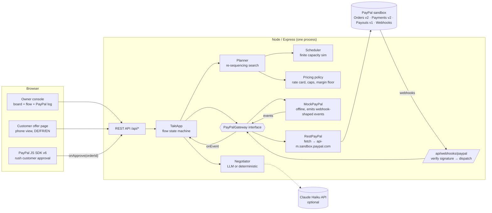
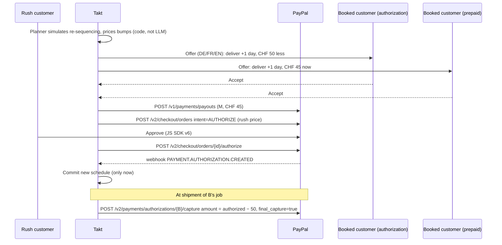

# Takt — architecture

> Airline bumping for factory schedules. When a job shop is full and a rush order arrives, Takt finds booked customers
> willing to wait, pays them for it through PayPal, and sells the freed slot to the rush customer.

## Diagram

## Money flow (the core mechanic)

## Modules

| Path | Role |
|---|---|
| `shared/types.ts` | Domain types shared by server and web |
| `server/domain/seed.ts` | Fictional shop "Werkstatt Reuss": 4 machines, 7 customers, 24 jobs. Due dates come from the baseline schedule plus slack |
| `server/domain/scheduler.ts` | Deterministic finite-capacity dispatch simulation: hour grid, 8 h/day, release days, operation precedence |
| `server/domain/planner.ts` | "Make room" search over the insert position × subsets of flexible jobs. Feasibility: the rush job is on time, firm promises are kept, and a bumped job waits ≤ its max delay. Objective: lowest compensation |
| `server/domain/pricing.ts` | Rate card and policy: compensation cap 12 %, margin floor CHF 150, rush factor |
| `server/agent/negotiator.ts` | `Negotiator` interface. Deterministic version: intake parsing and DE/FR/EN offer templates. The LLM version slots in behind it |
| `server/paypal/gateway.ts` | `PayPalGateway` interface: every money move |
| `server/paypal/mock.ts` | Offline implementation, used until credentials exist and for tests |
| `server/paypal/rest.ts` | Sandbox REST client: OAuth, Orders, Payments, Payouts, webhook verification |
| `server/app.ts` | Flow state machine: intake → plan → offers → accept/decline → rush authorization → commit on webhook → ship (capture less) / cancel (void) |
| `web/src/*` | React UI: owner console (board, flow panel, PayPal log) and the `#/offer/:id` customer page |

## Principles

- **The LLM words things; code decides.** Prices, compensation caps, margin and feasibility are all deterministic, so the agent can't give money away.
- **The schedule only commits when PayPal confirms** (the webhook, or a reconcile poll). The UI polls every 1 s, which also covers webhooks that arrive late.
- **Compensation follows how the customer paid:**
  - booked with an authorization → capture less at shipment, so no extra money movement is needed;
  - prepaid → Payout.
- **Demo safety:**
  - offline mock gateway and deterministic agent;
  - "Reset demo";
  - `npm test` runs the full demo path 10 times.

## Next (phase 2)

1. Bryntum Scheduler Pro replaces `Board.tsx` (trial starts ≥ 31 Oct). Machines become resources and ops become events; ghost events show the proposal, and the accepted plan animates in.
2. RestPayPal day-1 checks (see SPIKE.md); JS SDK v6 button for the rush customer.
3. LLM negotiator (Claude Haiku), plus free-text reply parsing for counter-offers.
4. Typed agent tools over the gateway next to `@paypal/agent-toolkit` tools.
5. Hosting on Render, plus README and THIRD_PARTY.md.
