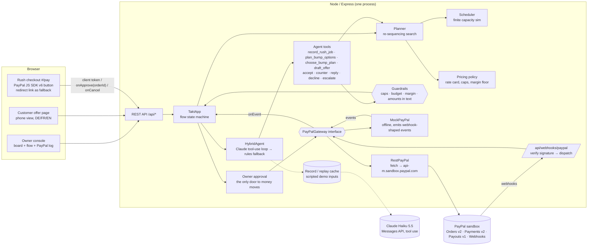
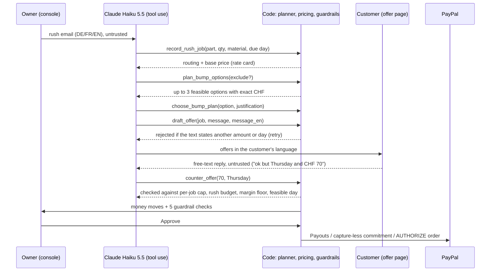
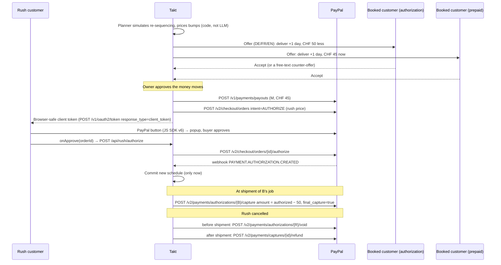

# Takt — architecture

> Airline bumping for factory schedules. When a job shop is full and a rush order arrives, Takt finds booked customers
> willing to wait, pays them for it through PayPal, and sells the freed slot to the rush customer.

## Diagram

## The agent (phase 2)

**What is AI and what is code.**

AI does the reading and the writing:
- turns a free-text request into a structured job;
- decides which planner option to propose and why (relationships, flexibility, cost);
- writes the offers in DE/FR/EN;
- interprets replies (accept, decline, counter, question, manipulation) and words the answers.

Code does the numbers and the money:
- routing hours, prices and feasibility;
- every amount and every cap;
- which money moves exist and who receives them;
- moving the money, and only after the owner approves.

**Guardrails (all in `server/agent/guardrails.ts`, re-checked in `app.ts`):**

| Guardrail | Rule |
|---|---|
| Per-job cap | Compensation ≤ 12 % of the bumped job's price |
| Rush budget | All compensations of one rush together ≤ 60 % of its rush premium |
| Margin floor | Net uplift ≥ CHF 150 |
| Feasible date | A counter can only move a delivery later than the planner's date, never earlier |
| Amounts in text | Every message to a customer must state the approved amount, and no CHF amount above the cap |
| Payees | Payees come from booking records; no tool takes an email, IBAN or URL |
| Untrusted input | Customer text sits in `<customer_reply>` tags marked untrusted. Suspicious replies go to `escalate_to_owner`, which changes nothing |
| Human in the loop | No PayPal call happens before the owner clicks "Approve & send to PayPal". The checks are re-run at that moment |

**Reliability.**
- `HybridAgent` falls back to the rule-based agent on any API error, rate limit, spend ceiling, refusal, or a run that does not finish. The header badge shows `Claude Haiku 5.5 · live`, `· recorded`, or `rules (fallback)` with the reason in a tooltip.
- **Record/replay:** `LlmClient` hashes the exact request (model, system, tools, messages) and stores the response in `server/agent/llm-cache/`. Prompts contain only relative days ("Wednesday next week"), never calendar dates, so the recordings stay valid every week.
- The scripted demo inputs therefore replay real Claude output at zero cost, and anything new goes live.
- `npm test` replays the recorded demo path 10 times and fails if a recording is stale.

## Money flow (the core mechanic)

**Rush checkout (JS SDK v6, verified in the sandbox on 26 Oct 2026).** The order is created on the server when the owner approves (intent `AUTHORIZE`, amount from the plan, `experience_context.locale = en-CH`). The checkout page loads `https://www.sandbox.paypal.com/web-sdk/v6/core`, gets a browser-safe client token from `GET /api/paypal/client-token` (falls back to the client id), calls `createInstance({ clientToken, components: ['paypal-payments'], pageType: 'checkout', locale: 'en-CH' })`, checks `findEligibleMethods({ currencyCode: 'CHF' })`, and starts a `createPayPalOneTimePaymentSession` with `presentationMode: 'auto'` and a promise that resolves to the existing `{ orderId }`. `onApprove` posts the order id to `/api/rush/authorize`; `onCancel` posts to `/api/rush/buyer-cancelled`. The redirect link (`payer-action` URL, `return_url` / `cancel_url`) stays as the fallback, and the reconcile poll catches an approval that neither path reports. All three paths are idempotent: the first one authorizes.

**PayPal timeline per job.** Every PayPal object a job touches is recorded on the job (`job.paypal`): booking authorization, agreed capture-less, payout batch, rush order → approval → authorization, capture, void, refund. Entries are marked as our call, the buyer's action, PayPal's confirmation (webhook or reconcile poll) or a live check ("Check in PayPal" runs `GET` on the authorization, capture and payout). Authorization, capture and refund ids link to the sandbox merchant view (needs the sandbox business login).

## Modules

| Path | Role |
|---|---|
| `shared/types.ts` | Domain types shared by server and web |
| `server/domain/seed.ts` | Fictional shop "Werkstatt Reuss": 4 machines, 7 customers, 24 jobs. Due dates come from the baseline schedule plus slack |
| `server/domain/scheduler.ts` | Deterministic finite-capacity dispatch simulation: hour grid, 8 h/day, release days, operation precedence |
| `server/domain/planner.ts` | "Make room" search over the insert position × subsets of flexible jobs. Feasibility: the rush job is on time, firm promises are kept, and a bumped job waits ≤ its max delay. Objective: lowest compensation |
| `server/domain/pricing.ts` | Rate card and policy: compensation cap 12 %, margin floor CHF 150, rush factor |
| `server/domain/routing.ts` | Part family, quantity and thickness to routing hours (code, not AI) |
| `server/agent/agent.ts` | `RushAgent` contract (intake, plan, reply) and relative-day helpers |
| `server/agent/claude.ts` | Claude Haiku 5.5 agent: manual tool-use loop with strict typed tools for three agent runs (intake, plan + offers, reply) |
| `server/agent/deterministic.ts` | Rule-based agent: regex intake (DE/FR/EN), cheapest option, templates, keyword reply parsing. The fallback |
| `server/agent/hybrid.ts` | Claude first, rules on any failure. `createAgent()` reads the `AGENT_*` env |
| `server/agent/llm.ts` | Messages API client with record/replay cache, spend ceiling, per-minute limit, and token/cost accounting |
| `server/agent/guardrails.ts` | Caps, budget, margin, date and amount-in-text checks, plus the owner-approval checklist |
| `scripts/agent-eval.ts` | `npm run agent:eval`: 17 cases (DE/FR/EN intake, plans, accept/decline/counter/over-cap/injection/question) with pass/fail and token cost → `docs/AGENT_EVAL.md` |
| `server/paypal/gateway.ts` | `PayPalGateway` interface: every money move |
| `server/paypal/mock.ts` | Offline implementation, used until credentials exist and for tests |
| `server/paypal/rest.ts` | Sandbox REST client: OAuth, JS SDK client token, Orders, Payments, Payouts, webhook verification. Reconciles by polling and emits `RECON-…` webhook-shaped events. Verified against the sandbox on 25 Oct 2026 |
| `scripts/sandbox-smoke.ts` | `npm run smoke:sandbox`: the whole money story against the real sandbox (rush authorize, capture less, refund, void, reauthorize guard, payout) |
| `scripts/paypal-approve.ts` | Headless sandbox buyer approval: redirect page (account login or guest test card) and the JS SDK v6 popup (account login) |
| `server/app.ts` | Flow state machine: intake → plan → offers → free-text replies → **owner approval** → payouts + rush authorization → commit on webhook → ship (capture less) / cancel rush (void before shipment, refund after) / live PayPal check |
| `web/src/*` | React UI: owner console (board, flow panel, PayPal log, per-job PayPal timeline), the `#/offer/:id` customer page and the `#/pay` rush checkout (`components/PayPal.tsx`: JS SDK v6) |

## Principles

- **The agent reads, chooses and writes; code prices and moves money.** Prices, compensation caps, margin and feasibility are all deterministic. Every tool call is validated, so the agent can't give money away, and nothing reaches PayPal without the owner's approval.
- **The schedule only commits when PayPal confirms** (the webhook, or a reconcile poll). The UI polls every 1 s, which also covers webhooks that arrive late.
- **Compensation follows how the customer paid:**
  - booked with an authorization → capture less at shipment, so no extra money movement is needed;
  - prepaid → Payout.
- **Demo safety:**
  - offline mock gateway and deterministic agent;
  - recorded Claude responses for the scripted inputs;
  - "Reset demo";
  - `npm test` runs the full demo path 10 times with the rules agent, and 10 times with recorded Claude responses.

## Next (phase 2)

1. Bryntum Scheduler Pro replaces `Board.tsx` (trial starts ≥ 31 Oct). Machines become resources and ops become events; ghost events show the proposal, and the accepted plan animates in.
2. ~~JS SDK v6 button for the rush customer~~: done (redirect kept as fallback).
3. ~~LLM negotiator plus free-text counter-offers~~: done (phase 2, see "The agent").
4. Expose the money moves as typed agent tools next to `@paypal/agent-toolkit` tools, for a buyer-agent MCP endpoint (stretch).
5. Hosting on Render (plan in [DEPLOY.md](DEPLOY.md), `render.yaml`), plus THIRD_PARTY.md.
